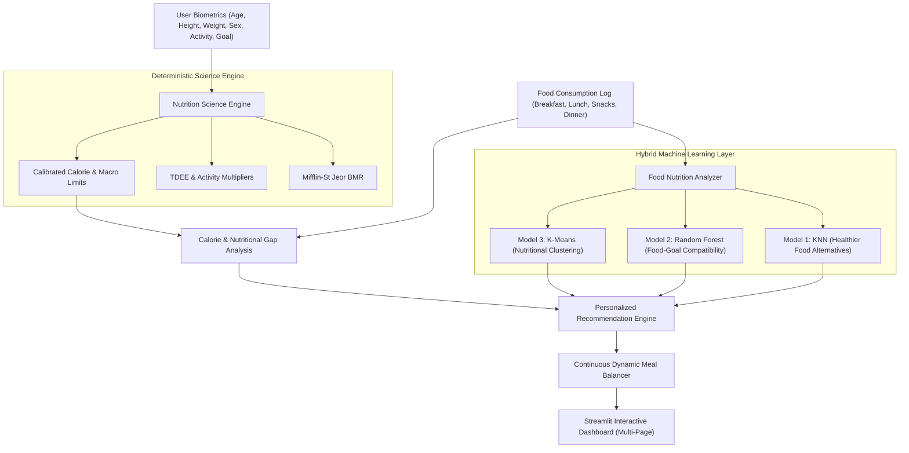
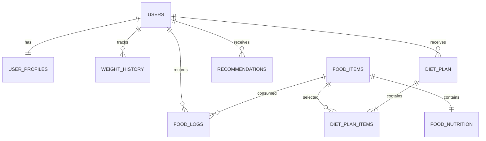

# NutriFit AI: An Intelligent Machine Learning-Based Food Nutrition Analysis and Personalized Diet Recommendation System

[](https://www.python.org/)
[](https://streamlit.io/)
[](https://scikit-learn.org/)
[](https://www.sqlalchemy.org/)
[](LICENSE)

---

## 🌟 Executive Overview & Core Innovation

Most calorie trackers are merely passive static calculators. **NutriFit AI** takes personal health technology to the next level: it is an **AI-powered Food Nutrition Analyzer and Personalized Diet Recommendation System** that evaluates what a person eats in real time, understands its physiological impact, and **continuously recalculates what they should eat next** based on their unique biometric profile and fitness goals.

### 💡 The Breakthrough: Continuous Dynamic Adaptation
> Instead of recommending a rigid diet once in the morning, **NutriFit AI continuously adapts its recommendations to real-world human behavior**.
>
> If a user consumes a packet of potato chips (270 kcal, 17g fat) or chocolate (135 kcal, 15g carbs, 8g fat), the system **does not** condemn the snack or demand extreme starvation. Instead, it computes the exact macronutrient footprint, recalculates the remaining daily allowance, and recommends wholesome, high-fiber, protein-dense options (e.g. Yellow Moong Dal, Roti, Cucumber Salad, Roasted Chana) to counterbalance the remaining meals.

---

## 🏗️ System Architecture



---

## 🤖 Machine Learning Model Architecture & Evaluation

NutriFit AI employs a **Hybrid Machine Learning + Rule-Based Recommendation Architecture**:

| Model | Purpose | Features / Methodology | Performance / Metric |
|---|---|---|---|
| **KNN (k-Nearest Neighbors)** | Healthier Food Alternatives & Smart Swaps | Cosine metric on standardized vector `[calories, protein, carbs, fat, fiber, sugar, sodium]` | Sub-millisecond similarity queries across 29,208 foods |
| **K-Means Clustering** | Nutritional Grouping & Food Archetypes | $k=6$ clusters (High-Protein, Fiber-Dense, Healthy Fats, Low-Calorie Produce, Sweets, Balanced) | **Silhouette Score: 0.4135** on 29,208 foods |
| **Random Forest Classifier** | Goal Suitability Compatibility Classification | 100 Estimators on `[age, bmi, activity_level, goal, calories, protein, carbs, fat, fiber, sugar, sodium]` | **Accuracy: 99.78%**, **Macro F1: 0.9971** on test set |

---

## 📊 Database Design (PostgreSQL / SQLite ORM)

Configured for out-of-the-box local operation via SQLite (`sqlite:///nutrifit.db`) or enterprise PostgreSQL via `.env` (`DATABASE_URL`).



---

## 🇮🇳 Indian Food Intelligence & Nutrition Composition

NutriFit AI integrates authentic **ICMR-NIN (Indian Council of Medical Research - National Institute of Nutrition)** Food Composition Tables combined with **USDA Comprehensive Foods** and **Open Food Facts API**:
- **Traditional Staples:** Moong Dal Tadka, Toor Dal, Chana Dal, Dal Makhani, Rajma Masala, Chole, Whole Wheat Roti, Bajra Roti, Jowar Roti, Steamed Rice, Brown Rice, Jeera Rice, Khichdi, Idli, Plain & Masala Dosa, Sambar, Coconut Chutney, Poha, Upma, Sprouted Moong Salad.
- **Dairy & Proteins:** Fresh Paneer (Raw, Tikka, Bhurji), Palak Paneer, Curd / Dahi, Spiced Chaas (Buttermilk), Sweet Lassi, Boiled Eggs, Egg Bhurji, Chicken Tikka, Fish Curry.
- **Smart Snack Substitutes:** Roasted Chana (Bengal gram), Roasted Makhana (Foxnuts), Unsweetened Cocoa Greek Yogurt Bowl, Fresh Fruit & Yogurt, Fresh Tender Coconut Water, Unsweetened Lemon Water (Nimbu Pani).
- **Packaged Snacks Analyzed:** Lay's India's Magic Masala, Kurkure Masala Munch, Cadbury Dairy Milk, Nestlé KitKat, Parle-G Biscuits, Maggi 2-Minute Noodles, Haldiram's Aloo Bhujia, Coca-Cola.

---

## 🚀 Getting Started

### 1. Clone & Set Up Python Environment
```bash
git clone <repo-url>
cd Diet_Planner
python -m venv venv
venv\Scripts\activate      # Windows
# source venv/bin/activate  # macOS / Linux
```

### 2. Install Dependencies
```bash
pip install -r requirements.txt
```

### 3. Launch the Application
```bash
streamlit run Home.py
```
*Open your browser at `http://localhost:8501` to explore NutriFit AI!*

---

## 📱 Application Modules & Pages

1. **Home (`Home.py`):** Interactive obsidian dark dashboard with circular calorie gauge, weight trend curve, triple macro rings (Protein, Carbs, Fat), essential nutrients RDA bar chart, dynamic feedback, and today's meal diary summary.
2. **User Profile (`pages/01_Profile.py`):** Biometric configuration, BMI healthy weight range calculator, Mifflin-St Jeor BMR calculator, TDEE activity multipliers, dietary preferences, and allergies.
3. **Food Nutrition Analyzer (`pages/02_Food_Analyzer.py`):** Search across 29,208 foods, portion scaling customizer, Open Food Facts live Barcode Scanner, and Nutrition Label OCR parser.
4. **Food Diary (`pages/03_Food_Diary.py`):** Breakfast, Lunch, Snacks, Dinner consumption log with delete capability and real-time remaining macro allowance progress.
5. **AI Recommendations (`pages/04_AI_Recommendations.py`):** KNN healthier alternatives with side-by-side radar comparison, Random Forest goal suitability predictor, and K-Means cluster explorer.
6. **Diet Planner (`pages/05_Diet_Planner.py`):** Daily & 7-day weekly Indian meal plans with automatic dynamic recalibration for logged food.
7. **Progress Analytics (`pages/06_Progress.py`):** Weight history tracking, spline trajectory curve, linear regression trend estimation (kg/week & 30-day projection).
8. **Clinical Reports (`pages/07_Reports.py`):** Downloadable PDF reports (via `fpdf2`), CSV export, and WHO dietary guideline compliance audit.

---

## ⚕️ Responsible Nutrition Principles

NutriFit AI is engineered with rigorous clinical boundaries:
- **Adult Target Population:** Designed for healthy adults aged 18+.
- **No Medical Claims:** Explicitly flags that BMR, TDEE, and BMI are statistical screening estimates, not medical prescriptions.
- **WHO Guidelines Adherence:** Promotes dietary adequacy, variety, minimum 25g daily fiber, and controlled thresholds for added sugar (<10% calories) and sodium (<2000mg).
- **Anti-Starvation Safeguard:** Never advises caloric intake below 1200 kcal/day regardless of aggressive deficit requests.

---

## 📄 License
This project is open-source under the MIT License.

