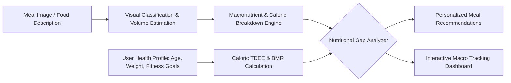

<div align="center">

  <!-- NATIVE ANIMATED CYBER BANNER -->
  

  <br/>

  <!-- ANIMATED TYPING SVG -->
  

  <br/>

  <!-- TECH BADGES -->
  <p align="center">
    
    
    
    
    
  </p>

</div>

---

### 🌟 System Overview

**NutriFit AI** is an intelligent food nutrition analyzer and personalized diet recommendation platform. Leveraging machine learning and dietary heuristics, it estimates caloric density, breaks down macronutrients (proteins, carbs, lipids), and formulates tailored dietary regimens based on user metabolic baselines and fitness goals.

---

### 🔬 Operational Architecture & Data Pipeline Flow



---

### 🚀 Key Capabilities & Features

- **🥗 Calorie & Macro Decomposition:** Instant quantification of proteins, carbohydrates, healthy fats, fiber, and micronutrients.
- **🎯 BMR & TDEE Calculations:** Calculates basal metabolic rates using the Mifflin-St Jeor formula adjusted for physical activity.
- **📈 Dynamic Nutrition Tracking:** Monitors weekly caloric deficits or surpluses to guide weight loss, muscle gain, or maintenance.
- **📋 Custom Recipe Alternatives:** Suggests healthy food substitutions to satisfy dietary restrictions (vegan, keto, diabetic-friendly).

---

### ⚡ Quickstart & Execution

```bash
# 1. Clone & enter
git clone https://github.com/Akshay-Notfound/NutriFit-AI.git
cd NutriFit-AI

# 2. Install requirements
pip install -r requirements.txt

# 3. Launch App
streamlit run app.py
```

---

### 👤 Author & Architecture

**Akshay Shivaji Rathod**  
*Data & AI Engineer*  
* 🌐 **Portfolio:** [akshay-notfound.vercel.app](https://akshay-notfound.vercel.app)  
* 💼 **LinkedIn:** [linkedin.com/in/akshay-rathod-aaab52206](https://www.linkedin.com/in/akshay-rathod-aaab52206/)  
* 🐙 **GitHub:** [@Akshay-Notfound](https://github.com/Akshay-Notfound)  

---

<div align="center">
  <sub>Licensed under the MIT License. Designed for scalability, intelligence, and performance.</sub>
</div>
