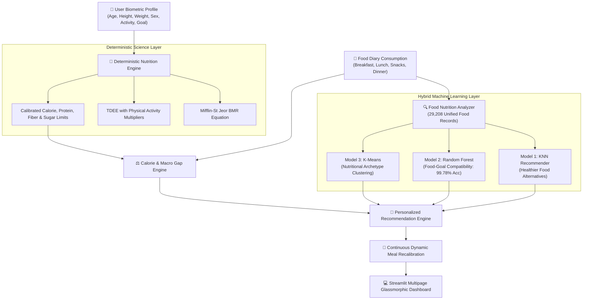

<div align="center">

# 🥗 NutriFit AI
### **Smart Food Nutrition Analyzer & Continuous Personalized Diet Recommendation System**

[](https://nutrifit-ai-diet.streamlit.app)
[](https://github.com/Akshay-Notfound/NutriFit-AI)
[](https://www.python.org/)

[](https://streamlit.io/)
[](https://scikit-learn.org/)
[](https://www.sqlalchemy.org/)
[](https://opensource.org/licenses/MIT)
[](#)

<p align="center">
  <a href="#-executive-summary--the-core-breakthrough"><strong>Explore Core Innovation</strong></a> •
  <a href="#-live-web-demo"><strong>Live Demo</strong></a> •
  <a href="#-system-architecture"><strong>Architecture</strong></a> •
  <a href="#-the-machine-learning-trio"><strong>ML Models</strong></a> •
  <a href="#-indian-food-intelligence"><strong>Indian Nutrition</strong></a> •
  <a href="#-getting-started"><strong>Quickstart</strong></a>
</p>

---

</div>

## 🌟 Executive Summary & The Core Breakthrough

Traditional fitness and calorie-tracking mobile apps are merely **passive calculators**: you log what you eat, they deduct calories, and they stop there. If you eat a cookie or a packet of chips, traditional apps simply flag a red bar or tell you to starve for the rest of the day.

**NutriFit AI revolutionizes this paradigm.** It is an intelligent, machine learning-powered nutrition science platform that:
1. **Analyzes what a user consumes in real time** across both raw foods and packaged branded snacks.
2. **Evaluates the deep nutritional impact** beyond simple calories (protein, dietary fiber, saturated fat, sodium, and added sugars).
3. **Continuously Adapts Dynamic Recommendations**: Instead of enforcing rigid once-a-day meal plans, NutriFit AI recalculates the user's remaining nutritional budget after every single snack or meal and dynamically recalibrates subsequent meals to naturally restore macronutrient balance.

---

### 🆚 Traditional Calorie Trackers vs. NutriFit AI

| Feature | Legacy Calorie Trackers (MyFitnessPal, HealthifyMe, etc.) | 🥗 NutriFit AI (Our Platform) |
|---|---|---|
| **Recommendation Engine** | Static; recommends a rigid plan once and cannot adapt | **Dynamic & Continuous**; recalculates subsequent meals after every snack |
| **Snack Handling** | Flags red bars or tells you to skip dinner | Recommends clean counterbalances (high-fiber dal, whole grains, salads) |
| **Healthy Alternatives** | Manual search or none | **KNN-Powered Smart Alternative Finder** (finds lower sugar/fat substitutes) |
| **Goal Compatibility** | Simple daily calorie progress bar | **Random Forest Classifier** predicting food-goal compatibility |
| **Nutritional Grouping** | Flat categories | **K-Means Unsupervised Clustering** ($k=6$ nutritional archetypes) |
| **Indian Food Intelligence** | Poor coverage of regional thalis / branded snacks | **Native ICMR-NIN Tables** (Roti, Dal, Paneer, Makhana, Chana, Idli, Poha, etc.) |
| **Barcode & OCR** | Often behind expensive paywalls | **Built-in Open Food Facts API & Label OCR Parser** |
| **Dietary Reports** | Basic daily summary | **Clinical PDF Report Generator (`fpdf2`)** with WHO compliance audit |

---

## 🚀 Live Web Demo

Experience the live application deployed on Streamlit Community Cloud:

👉 **[https://nutrifit-ai-diet.streamlit.app](https://nutrifit-ai-diet.streamlit.app)**

---

## 🏗️ System Architecture

NutriFit AI employs a **Hybrid Machine Learning + Deterministic Nutrition Science Architecture**:



---

## 🔬 Deterministic Nutrition Science Engine

Before applying machine learning, the foundation of NutriFit AI relies on deterministic clinical nutrition science:

### 1. Body Mass Index (BMI) & Screening
$$\text{BMI} = \frac{\text{Weight (kg)}}{(\text{Height (m)})^2}$$
- **Underweight**: $< 18.5$
- **Normal Range**: $18.5 \le \text{BMI} < 25.0$
- **Overweight**: $25.0 \le \text{BMI} < 30.0$
- **Obese**: $\ge 30.0$
- *Includes exact healthy weight range calculation for the user's height.*

### 2. Basal Metabolic Rate (BMR) — Mifflin-St Jeor Equation
Estimated energy expenditure at complete physiological rest:
- **Male**: $\text{BMR} = 10 \times W + 6.25 \times H - 5 \times A + 5$
- **Female**: $\text{BMR} = 10 \times W + 6.25 \times H - 5 \times A - 161$
*(where $W$ is weight in kg, $H$ is height in cm, and $A$ is age in years)*

### 3. Total Daily Energy Expenditure (TDEE) & Goal Targets
$$\text{TDEE} = \text{BMR} \times \text{ActivityFactor}$$

| Activity Level | Multiplier | Typical Routine |
|---|---|---|
| **Sedentary** | `1.200` | Desk job, minimal walking or exercise |
| **Lightly Active** | `1.375` | Light exercise / sports 1–3 days/week |
| **Moderately Active** | `1.550` | Moderate exercise / training 3–5 days/week |
| **Very Active** | `1.725` | Intense exercise / athletics 6–7 days/week |
| **Extra Active** | `1.900` | Heavy daily physical labor or training 2x/day |

- **Weight Loss Target**: $\text{TDEE} - 450\text{ kcal}$ (safe, sustainable fat-loss deficit)
- **Maintenance Target**: $\text{TDEE}$
- **Weight Gain / Hypertrophy Target**: $\text{TDEE} + 400\text{ kcal}$ (lean surplus)
- **Anti-Starvation Floor**: Minimum safety threshold of $\ge 1200\text{ kcal/day}$.

### 4. WHO Evidence-Based Dietary Guardrails
- **Dietary Fiber**: $\ge 25\text{g – }30\text{g / day}$ (promotes gut microbiome, regulates LDL & glycemic index)
- **Added Sugar Limit**: $< 5\%\text{ – }10\%$ of daily energy intake ($< 25\text{g – }35\text{g}$)
- **Sodium Ceiling**: $< 2000\text{mg / day}$ (cardiovascular risk prevention)
- **Daily Water Intake**: $\approx 35\text{ ml / kg body weight}$

---

## 🤖 The Machine Learning Trio

NutriFit AI combines three specialized models to handle recommendation, classification, and clustering:

```
                            ┌──────────────────────────────────────────────┐
                            │           NutriFit AI ML Models              │
                            └──────────────────────┬───────────────────────┘
                                                   │
        ┌──────────────────────────────────────────┼────────────────────────────────────────┐
        ▼                                          ▼                                        ▼
┌──────────────────────────────┐    ┌──────────────────────────────┐    ┌──────────────────────────────┐
│       Model 1: KNN           │    │    Model 2: Random Forest    │    │      Model 3: K-Means        │
├──────────────────────────────┤    ├──────────────────────────────┤    ├──────────────────────────────┤
│ • Task: Healthier Food Swaps │    │ • Task: Goal Compatibility   │    │ • Task: Nutritional Clusters │
│ • Metric: Cosine Similarity  │    │ • Accuracy: 99.78%           │    │ • Clusters: k = 6            │
│ • Features: 7-Dim Normalized │    │ • Macro F1-Score: 0.9971     │    │ • Silhouette Score: 0.4135   │
│ • Database: 29,208 Foods     │    │ • 100 Decision Trees         │    │ • Food Archetype Profiling   │
└──────────────────────────────┘    └──────────────────────────────┘    └──────────────────────────────┘
```

### Model 1: k-Nearest Neighbors (KNN) Food Recommender
- **Standardized Feature Space**: `[calories, protein, carbohydrates, fat, fiber, sugar, sodium]` normalized via `StandardScaler`.
- **Inference Strategy**: Computes nearest cosine neighbors and filters for candidates with superior nutritional attributes (higher protein/fiber, reduced sugar/saturated fat).
- **Curated Indian Healthier Swaps**:
  * **Lay's Potato Chips / Kurkure** $\rightarrow$ **Roasted Chana**, **Roasted Makhana**, or **Moong Sprouts Salad**
  * **Cadbury Milk Chocolate** $\rightarrow$ **Unsweetened Cocoa Greek Yogurt Bowl** or **Fresh Fruit Bowl**
  * **Carbonated Soft Drink** $\rightarrow$ **Unsweetened Lemon Water (Nimbu Pani)** or **Tender Coconut Water**
  * **Deep Fried Samosa** $\rightarrow$ **Roasted Makhana** or **Besan Chilla**

### Model 2: Random Forest Goal-Compatibility Classifier
- **Features**: `[age, bmi, activity_level, fitness_goal, calories, protein, carbs, fat, fiber, sugar, sodium]`
- **Predicted Classes**:
  1. `Fits your daily nutrition goals` ✅
  2. `Fits in moderation` ⚠️
  3. `Consider a more nutrient-dense alternative` 🛑
- **Evaluation Benchmark**:

```
                                            Precision    Recall    F1-Score   Support
Fits your daily nutrition goals                  1.00      1.00        1.00      1846
Fits in moderation                               1.00      1.00        1.00      1148
Consider a more nutrient-dense alternative       1.00      1.00        1.00       606

Overall Accuracy:                                                      99.78%     3600
Macro Average F1:                                                      0.9971     3600
```

### Model 3: K-Means Nutritional Clustering
- **Clusters ($k=6$)**:
  * `Cluster 0`: *Low-Calorie & Hydrating Produce* (11,437 foods)
  * `Cluster 1`: *Fiber & Nutrient-Dense Grains / Legumes* (5,871 foods)
  * `Cluster 2`: *Calorie-Dense Healthy Fats & Nuts* (2,059 foods)
  * `Cluster 3`: *High-Protein & Lean Fuel* (6,260 foods)
  * `Cluster 4`: *High-Protein Specialized Fuel*
  * `Cluster 5`: *High-Sugar & Confectionery Treats* (3,580 foods)
- **Silhouette Benchmark**: **`0.4135`** on 29,208 unified foods.

---

## 🇮🇳 Indian Food Intelligence & Cultural Dietetics

NutriFit AI directly solves the blind spot of Western diet apps by natively understanding Indian meal combinations:

```
                    ┌────────────────────────────────────────────────────────┐
                    │              Authentic Indian Staples Crated           │
                    └───────────────────────────┬────────────────────────────┘
                                                │
    ┌───────────────────────┬───────────────────┴───────────────────┬───────────────────────┐
    ▼                       ▼                                       ▼                       ▼
┌──────────────────┐    ┌──────────────────┐    ┌───────────────────────┐    ┌───────────────────┐
│ Grains & Breads  │    │ Dals & Legumes   │    │ Dairy & Proteins      │    │ Regional Breakfast│
├──────────────────┤    ├──────────────────┤    ├───────────────────────┤    ├───────────────────┤
│ • Whole Wheat    │    │ • Yellow Moong   │    │ • Fresh Paneer Raw    │    │ • Poha w/ Peanuts │
│   Roti / Chapati │    │   Dal Tadka      │    │ • Paneer Tikka /      │    │ • Vegetable Upma  │
│ • Bajra Roti     │    │ • Toor / Arhar   │    │   Bhurji              │    │ • Idli + Sambar   │
│ • Jowar Roti     │    │ • Chana Dal      │    │ • Palak Paneer        │    │ • Plain & Masala  │
│ • Steamed Rice   │    │ • Rajma Masala   │    │ • Spiced Chaas        │    │   Dosa            │
│ • Brown Rice     │    │ • Chole Masala   │    │ • Plain Curd / Dahi   │    │ • Besan Chilla    │
│ • Moong Khichdi  │    │ • Kala Chana     │    │ • Boiled Eggs         │    │ • Sprouts Chaat   │
│ • Plain Paratha  │    │ • Moong Sprouts  │    │ • Chicken Tikka       │    │ • Roasted Makhana │
└──────────────────┘    └──────────────────┘    └───────────────────────┘    └───────────────────┘
```

---

## 📱 Application Modules & Pages

The application is structured into **8 modular pages** matching modern healthcare interface guidelines:

| Page | File | Core Functionality |
|---|---|---|
| **Dashboard** | `Home.py` | Circular SVG/Plotly calorie gauge, weight trend curve, triple macro rings (Protein, Carbs, Fat), essential nutrients RDA bar chart, dynamic feedback, and today's meal diary summary. |
| **01 Profile** | `pages/01_Profile.py` | Biometric configuration, live BMI classification with healthy weight range, Mifflin-St Jeor BMR calculator, TDEE physical activity multipliers, dietary preferences, and allergies. |
| **02 Food Analyzer** | `pages/02_Food_Analyzer.py` | Real-time search across 29,208 foods, portion scaling customizer, Open Food Facts live Barcode Scanner, and Nutrition Label OCR text parser. |
| **03 Food Diary** | `pages/03_Food_Diary.py` | Categorized consumption log (Breakfast, Lunch, Snacks, Dinner), item deletion, and real-time remaining macro allowance progress bars. |
| **04 AI Recommendations** | `pages/04_AI_Recommendations.py` | KNN healthier alternatives with side-by-side radar comparison, Random Forest goal suitability predictor, and K-Means cluster browser. |
| **05 Diet Planner** | `pages/05_Diet_Planner.py` | Daily & 7-day weekly Indian meal plans with automatic dynamic recalibration for logged food. |
| **06 Progress** | `pages/06_Progress.py` | Weight history tracking, spline trajectory curve, linear regression trend estimation (kg/week & 30-day projection). |
| **07 Reports** | `pages/07_Reports.py` | Downloadable PDF reports (via `fpdf2`), CSV export, and WHO dietary guideline compliance audit. |

---

## 📊 Database Schema (SQLAlchemy ORM)

NutriFit AI runs out-of-the-box on local SQLite (`sqlite:///nutrifit.db`) and automatically seeds **29,208 foods** on initial boot. It seamlessly switches to PostgreSQL when `DATABASE_URL` is set in `.env` or Streamlit Secrets.

```
       ┌────────────────────────┐                   ┌────────────────────────┐
       │         USERS          │                   │       FOOD_ITEMS       │
       ├────────────────────────┤                   ├────────────────────────┤
       │ user_id (PK)           │                   │ food_id (PK)           │
       │ name, email            │                   │ name, category, brand  │
       │ password_hash          │                   │ serving_size, unit     │
       └───────────┬────────────┘                   └───────────┬────────────┘
                   │                                            │
       ┌───────────┼────────────────────────┐                   │
       ▼           ▼                        ▼                   ▼
┌──────────────┐ ┌────────────────┐ ┌───────────────┐ ┌──────────────────────┐
│USER_PROFILES │ │  WEIGHT_HISTORY│ │   FOOD_LOGS   │ │    FOOD_NUTRITION    │
├──────────────┤ ├────────────────┤ ├───────────────┤ ├──────────────────────┤
│ user_id (FK) │ │ user_id (FK)   │ │ user_id (FK)  │ │ food_id (FK)         │
│ age, sex     │ │ weight         │ │ food_id (FK)  │ │ calories, protein    │
│ height,weight│ │ recorded_at    │ │ quantity, meal│ │ carbs, fat, fiber    │
│ goal, activity│ └────────────────┘ └───────────────┘ │ sugar, sodium, etc.  │
└──────────────┘                                      └──────────────────────┘
```

---

## ⚡ Quickstart & Installation

### 1. Clone Repository
```bash
git clone https://github.com/Akshay-Notfound/NutriFit-AI.git
cd NutriFit-AI
```

### 2. Set Up Virtual Environment
```bash
# Windows
python -m venv venv
venv\Scripts\activate

# macOS / Linux
python3 -m venv venv
source venv/bin/activate
```

### 3. Install Dependencies
```bash
pip install -r requirements.txt
```

### 4. Run Integration Tests
```bash
python test_pipeline.py
```
*(Executes 8 automated tests validating database seeding, nutrition calculations, KNN queries, Random Forest inference, dynamic balancing, and PDF generation).*

### 5. Launch Application
```bash
streamlit run Home.py
```
Open **`http://localhost:8501`** in your browser.

---

## 🌐 Deploy to Streamlit Community Cloud

NutriFit AI is pre-configured for **Streamlit Community Cloud** with `.streamlit/config.toml` dark theme settings:

1. Fork or push this repository to your GitHub.
2. Go to [share.streamlit.io](https://share.streamlit.io).
3. Select your repository: `Akshay-Notfound/NutriFit-AI`.
4. Set Branch: `main` and Main file path: `Home.py`.
5. Click **Deploy!** 🎈

---

## ⚕️ Responsible Nutrition Principles & Safety Guardrails

Because nutrition directly impacts physical well-being, NutriFit AI strictly enforces responsible clinical boundaries:
- **Target Population**: Intended for healthy adults aged 18 and older.
- **Screening, Not Medical Prescriptions**: Clearly notes that BMI, BMR, and TDEE are mathematical screening estimates, not clinical diagnoses.
- **No Crash Starvation**: Safeguards prevent the daily calorie recommendation from ever falling below **1,200 kcal/day**, regardless of user-selected deficit targets.
- **Empirical Trend Projections**: Historical weight trends are modeled via linear regression as statistical reference trajectories, clearly distinguished from medical guarantees.

---

## 📄 License
This project is open-source under the [MIT License](LICENSE).

---

<div align="center">
  <sub>Engineered with Python, Scikit-learn, Nutrition Science & Streamlit by Akshay.</sub>
</div>
